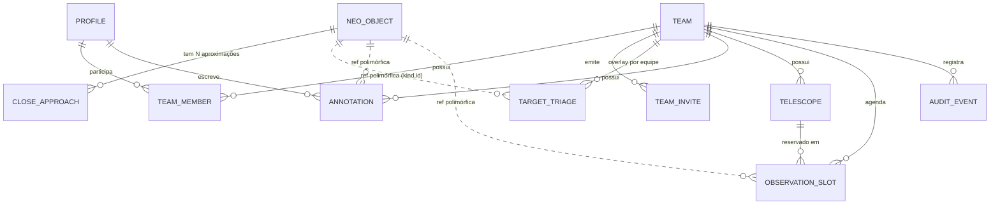

# ExoOps Mission Control: especificação técnica (MVP e fundação)

> **Status:** planejamento. Este documento define escopo, contratos de dados e decisões de arquitetura. Nenhum código de implementação foi escrito.
> **Fonte de verdade dos tipos:** os contratos da seção 2 são a referência para qualquer componente (ver `.clinerules`, seção 1).

## Sumário

0. Contexto do workspace e premissas
1. Ideação e escopo do MVP
2. Modelagem de domínio e contratos
3. Arquitetura frontend e padrões
4. Segurança, autenticação e integrações
5. Plano de execução fatiado
6. Decisões em aberto

---

## 0. Contexto do workspace e premissas

| Achado | Implicação |
|---|---|
| O projeto é o **template Vite + React 19 + TS** (`vite.config.ts`, `index.html`, `src/main.tsx`). Não há Next.js, Tailwind, Supabase nem TanStack Query. | O alvo é Next.js App Router, então o Vite não é a base. Recomendação: **descartar o scaffold** (não há código de negócio) e inicializar o Next.js no mesmo diretório. |
| Não é um repositório git. | O primeiro passo do plano é `git init`. |
| `package.json` usa `typescript ~7.0.2`. | Antes de fixar a versão, **verificar a compatibilidade** com Next.js, `typescript-eslint` e Tailwind. Se houver atrito, fixar a versão do TS que o Next suporta oficialmente. |

Premissas adotadas:
1. O MVP entrega **NEOs completos de ponta a ponta**. Exoplanetas têm contrato modelado, mas a UI fica na v2.
2. O catálogo NASA é público (leitura anônima). Todo o resto exige login.
3. Papéis são **por equipe** (turma ou clube), não globais.

---

## 1. Ideação e escopo do MVP

### 1.1 Core Value

> **"Transformar a telemetria bruta da NASA em uma fila de trabalho: explorar, triar, anotar, aprovar e agendar a observação, com permissões reais."**

O diferencial não é mostrar dados da NASA. É o **fluxo operacional com papéis** sobre esses dados.

| MVP (entra) | Backlog v2 (fora, de forma explícita) |
|---|---|
| Catálogo de **aproximações de NEOs** (NeoWS) com paginação, ordenação e filtros no servidor | UI de exoplanetas (Exoplanet Archive TAP). O contrato já existe e a tabela é polimórfica. |
| Filtros por diâmetro (km), velocidade (km/s), distância (LD/AU), data e PHA | Gamificação real (XP, rankings, conquistas, missões). No MVP só há vocabulário e identidade visual de "missão". |
| Gráfico de dispersão distância × velocidade, com os mesmos filtros e alternativa em tabela acessível | Troca de equipe (team switcher), múltiplas equipes por tela |
| Detalhe do NEO com linha do tempo de aproximações | Upload de mídia (fotos de observação) via Supabase Storage |
| Triagem por equipe: `Novo → Revisado / Em Observação / Falso Positivo` (somente gestor) e flag de **prioridade** (somente gestor) | Notificações por e-mail (aprovou, rejeitou, janela agendada) |
| Anotações com fluxo `rascunho → enviada → aprovada/rejeitada` | Exportação de relatório PDF para feiras e OBA |
| Agendamento: telescópios da equipe e janelas de observação, sem sobreposição | Calendário visual completo, integração com efemérides e visibilidade por latitude |
| Auth (magic link e Google), equipes, convites por código, RBAC com RLS | i18n (en/es), tema claro e white-label por equipe |
| Cache e ingestão da NASA, com degradação elegante em caso de 429 | Realtime (Supabase Realtime), PWA offline, keyset pagination |
| Trilha de auditoria das ações do gestor | Pagamentos (não há modelo de negócio no MVP) |

### 1.2 Top 3 jornadas

**J1: Explorar e identificar alvos candidatos** (Operador ou Visualizador)
> Como **estudante**, quero filtrar aproximações por diâmetro, velocidade e distância e ver o gráfico de dispersão correspondente, para escolher um alvo para meu projeto da OBA.

Critérios de aceite:
- Dado o dashboard, quando aplico qualquer filtro, então a tabela e o gráfico refletem **o mesmo conjunto**. A URL guarda o estado (`?vMin=10&ldMax=20&page=2`) e é compartilhável.
- A paginação e a ordenação acontecem **no servidor**. A página traz no máximo 25 linhas e o total aparece no rodapé.
- Ao trocar de página ou filtro, a tabela anterior continua visível com indicador de carregamento. Não há "piscada" em branco.
- Valores sempre mostram unidade (km/s, LD, AU, km). Há conversão LD ↔ AU documentada em uma única função utilitária.
- Se a NASA estiver indisponível ou com cota esgotada, os dados do banco continuam sendo servidos com um aviso "dados de {data}".
- O gráfico possui alternativa em tabela e é navegável por teclado, e o status nunca é indicado só por cor.
- O visitante anônimo consegue usar J1 (somente leitura, sem overlay de triagem).

**J2: Registrar uma anotação científica** (Operador)
> Como **estudante**, quero escrever um relatório sobre um NEO e enviá-lo para validação, para que meu professor o aprove e ele conte no projeto.

Critérios de aceite:
- Operador cria e edita **apenas os próprios** rascunhos. Ao enviar, o status vira `submitted` e a edição é bloqueada.
- Operador **não consegue**, nem por chamada direta à API, aprovar a própria anotação ou alterar a anotação de outro (provado por teste de RLS).
- O corpo é Markdown, sanitizado na renderização, limitado a 5.000 caracteres e validado com zod no servidor.
- O Visualizador vê as anotações aprovadas da equipe, mas não vê o botão "Nova anotação". Na API recebe `FORBIDDEN`.
- A anotação aparece no detalhe do NEO e na lista "Meus logs" com seu status.

**J3: Triar, priorizar e agendar** (Gestor)
> Como **professor**, quero revisar a fila, definir o status de risco, marcar alvos prioritários e reservar uma janela no telescópio, para organizar a observação do clube.

Critérios de aceite:
- Só o Gestor altera `TriageStatus` (`Revisado`, `Em Observação`, `Falso Positivo`) e `isPriority`. A mudança é refletida na UI em menos de 1 s (otimista, com rollback em erro) e registrada em `audit_events`.
- A fila de revisão lista anotações `submitted`, mais antigas primeiro. O Gestor aprova ou rejeita, com nota opcional (obrigatória na rejeição).
- Ao criar uma janela de observação, um conflito no mesmo telescópio e horário é **rejeitado pelo banco** (constraint de exclusão), com mensagem clara na UI.
- A prioridade e o status são **por equipe**. O que o professor A define não vaza nem afeta a equipe B.

### 1.3 Métricas de sucesso observáveis

| Dimensão | Métrica | Meta (piloto: 1 turma de 20–30 alunos, 2 semanas) | Fonte |
|---|---|---|---|
| Ativação | % de usuários que criam ≥1 anotação na 1ª semana | ≥ 50% | SQL em `annotations` |
| Valor | Anotações aprovadas ao fim do piloto | ≥ 15 | SQL |
| Fluxo | Mediana do tempo `submitted → reviewed` | < 48 h | SQL (`reviewed_at - submitted_at`) |
| Eficiência | Tempo entre login e abrir um NEO com filtro aplicado | < 60 s (teste com 5 usuários) | Teste moderado e Playwright |
| Performance | p75 da resposta de `/api/neo/approaches` | < 500 ms; LCP < 2,5 s | Vercel Analytics e Speed Insights |
| Custo e cota | Chamadas à NASA por dia / respostas 429 | < 100/dia / 0 | tabela `sync_runs` |
| Segurança | Matriz de testes RLS (papel × tabela × operação) | 100% verde no CI | pgTAP ou Vitest |
| Acessibilidade | Lighthouse a11y e axe (violações críticas) | ≥ 95 / 0 | CI |
| Custo | Gasto mensal | US$ 0 | painéis Vercel e Supabase |

---

## 2. Modelagem de domínio e contratos

### 2.1 Entidades e relacionamentos

Princípio central: o catálogo é global e a camada operacional é privada por equipe.



Decisões de modelagem:
- **O grão da listagem é a aproximação (`CloseApproach`), não o NEO.** Distância e velocidade são atributos da aproximação, e os filtros e o gráfico dependem deles. O NEO é a dimensão (diâmetro, PHA).
- **Referência polimórfica** `ObjectRef = (kind, id)` nas tabelas operacionais. Isso prepara exoplanetas sem migração. O custo é não ter FK para o catálogo, então a integridade é garantida na Server Action, que valida que o NEO existe em `neo_objects`.
- **Triagem é por equipe**, com chave `(team_id, kind, object_id)`.
- Tabelas de catálogo (`neo_objects`, `close_approaches`) e `sync_runs` são **somente escrita por service role** (cron).

### 2.2 Contratos TypeScript (`src/contracts/`)

```ts
// ───────────── ids.ts ─────────────
declare const __brand: unique symbol;
export type Brand<T, B extends string> = T & { readonly [__brand]: B };

export type UserId = Brand<string, 'UserId'>;
export type TeamId = Brand<string, 'TeamId'>;
export type InviteId = Brand<string, 'InviteId'>;
export type NeoId = Brand<string, 'NeoId'>;               // id NASA (SPK-ID), ex.: "2465633"
export type ApproachId = Brand<string, 'ApproachId'>;     // `${neoId}:${epochMs}`
export type ExoplanetId = Brand<string, 'ExoplanetId'>;   // slug de pl_name (v2)
export type AnnotationId = Brand<string, 'AnnotationId'>;
export type TelescopeId = Brand<string, 'TelescopeId'>;
export type SlotId = Brand<string, 'SlotId'>;
export type IsoDateTime = Brand<string, 'IsoDateTime'>;   // UTC, ISO-8601
export type IsoDate = Brand<string, 'IsoDate'>;           // YYYY-MM-DD

// ───────────── enums.ts ─────────────
export const ROLES = ['viewer', 'operator', 'chief'] as const;
export type Role = (typeof ROLES)[number];

export const TRIAGE_STATUSES = ['new', 'reviewed', 'under_observation', 'false_positive'] as const;
export type TriageStatus = (typeof TRIAGE_STATUSES)[number];
// rótulos pt-BR: Novo | Revisado | Em Observação | Falso Positivo

export const ANNOTATION_STATUSES = ['draft', 'submitted', 'approved', 'rejected'] as const;
export type AnnotationStatus = (typeof ANNOTATION_STATUSES)[number];

export const SLOT_STATUSES = ['planned', 'confirmed', 'cancelled', 'completed'] as const;
export type SlotStatus = (typeof SLOT_STATUSES)[number];

export type ObjectKind = 'neo' | 'exoplanet';
export type ObjectRef =
  | { readonly kind: 'neo'; readonly id: NeoId }
  | { readonly kind: 'exoplanet'; readonly id: ExoplanetId };

// ───────────── catálogo (global, vindo da NASA) ─────────────
export interface Range<T> { readonly min: T; readonly max: T }

export interface NeoObject {
  readonly id: NeoId;
  readonly name: string;                    // ex.: "(2024 YR4)"
  readonly designation: string;
  readonly absoluteMagnitudeH: number;
  readonly diameterKm: Range<number>;       // estimated_diameter.kilometers
  readonly isPotentiallyHazardous: boolean; // is_potentially_hazardous_asteroid
  readonly isSentryObject: boolean;
  readonly jplUrl: string;
  readonly syncedAt: IsoDateTime;
}

export interface MissDistance {
  readonly ld: number;   // distâncias lunares
  readonly au: number;
  readonly km: number;
}

export interface CloseApproach {
  readonly id: ApproachId;
  readonly neoId: NeoId;
  readonly approachAt: IsoDateTime;         // epoch_date_close_approach → UTC
  readonly relativeVelocityKmS: number;     // NeoWS entrega string; o mapper converte
  readonly missDistance: MissDistance;
  readonly orbitingBody: string;            // "Earth"
}

// Contrato da v2 (sem UI no MVP)
export interface Exoplanet {
  readonly id: ExoplanetId;
  readonly name: string;                    // pl_name
  readonly hostStar: string;                // hostname
  readonly discoveryYear: number | null;
  readonly discoveryMethod: string | null;
  readonly radiusEarth: number | null;      // pl_rade
  readonly massEarth: number | null;        // pl_bmasse
  readonly orbitalPeriodDays: number | null;
  readonly equilibriumTempK: number | null;
  readonly distanceParsec: number | null;   // sy_dist
}

// ───────────── tenancy e acesso ─────────────
export interface Profile {
  readonly id: UserId;
  readonly displayName: string;             // minimização de PII (LGPD)
  readonly createdAt: IsoDateTime;
}
export interface Team {
  readonly id: TeamId;
  readonly name: string;
  readonly createdAt: IsoDateTime;
}
export interface TeamMember {
  readonly teamId: TeamId;
  readonly userId: UserId;
  readonly role: Role;
  readonly joinedAt: IsoDateTime;
}
export interface TeamInvite {
  readonly id: InviteId;
  readonly teamId: TeamId;
  readonly codeHash: string;                // o código em claro só é exibido uma vez
  readonly role: Exclude<Role, 'chief'>;    // convite nunca promove a gestor
  readonly expiresAt: IsoDateTime;
  readonly maxUses: number;
  readonly usedCount: number;
}

// ───────────── camada operacional (por equipe) ─────────────
export interface TargetTriage {
  readonly teamId: TeamId;
  readonly object: ObjectRef;
  readonly status: TriageStatus;
  readonly isPriority: boolean;
  readonly priorityNote: string | null;
  readonly updatedBy: UserId;
  readonly updatedAt: IsoDateTime;
}

export interface AnnotationReview {
  readonly reviewerId: UserId;
  readonly decision: 'approved' | 'rejected';
  readonly note: string | null;             // obrigatória quando rejected
  readonly reviewedAt: IsoDateTime;
}
export interface Annotation {
  readonly id: AnnotationId;
  readonly teamId: TeamId;
  readonly object: ObjectRef;
  readonly authorId: UserId;
  readonly title: string;                   // 3..120
  readonly bodyMd: string;                  // ≤ 5000, sanitizado na renderização
  readonly status: AnnotationStatus;
  readonly review: AnnotationReview | null;
  readonly createdAt: IsoDateTime;
  readonly updatedAt: IsoDateTime;
}

export interface Telescope {
  readonly id: TelescopeId;
  readonly teamId: TeamId;
  readonly name: string;
  readonly apertureMm: number | null;
  readonly notes: string | null;
}
export interface ObservationSlot {
  readonly id: SlotId;
  readonly teamId: TeamId;
  readonly telescopeId: TelescopeId;
  readonly object: ObjectRef;
  readonly startsAt: IsoDateTime;
  readonly endsAt: IsoDateTime;             // > startsAt (CHECK)
  readonly status: SlotStatus;
  readonly createdBy: UserId;
  readonly notes: string | null;
}

export interface AuditEvent {              // append-only
  readonly id: string;
  readonly teamId: TeamId;
  readonly actorId: UserId;
  readonly action:
    | 'triage.set_status' | 'triage.set_priority'
    | 'annotation.review' | 'slot.create' | 'slot.cancel' | 'invite.create';
  readonly target: ObjectRef | { readonly kind: 'annotation' | 'slot'; readonly id: string };
  readonly payload: Readonly<Record<string, unknown>>;
  readonly at: IsoDateTime;
}

// ───────────── RBAC (espelho no cliente e no servidor; a RLS é a barreira real) ─────────────
export type Permission =
  | 'catalog.read' | 'team.read'
  | 'annotation.create' | 'annotation.review'
  | 'triage.write' | 'priority.write'
  | 'slot.write' | 'invite.manage';

export const ROLE_PERMISSIONS: Readonly<Record<Role, readonly Permission[]>> = {
  viewer:   ['catalog.read', 'team.read'],
  operator: ['catalog.read', 'team.read', 'annotation.create'],
  chief:    ['catalog.read', 'team.read', 'annotation.create', 'annotation.review',
             'triage.write', 'priority.write', 'slot.write', 'invite.manage'],
};

// ───────────── contratos de API ─────────────
export interface NeoApproachFilters {
  readonly dateFrom?: IsoDate;
  readonly dateTo?: IsoDate;
  readonly diameterKm?: Partial<Range<number>>;
  readonly velocityKmS?: Partial<Range<number>>;
  readonly missDistanceLd?: Partial<Range<number>>;  // LD é a unidade canônica; AU é derivada
  readonly hazardousOnly?: boolean;
  readonly triage?: readonly TriageStatus[];          // exige sessão
  readonly priorityOnly?: boolean;                    // exige sessão
  readonly q?: string;
  readonly sort: 'approachAt' | 'missDistanceLd' | 'velocityKmS' | 'diameterMaxKm';
  readonly dir: 'asc' | 'desc';
  readonly page: number;                              // ≥ 1
  readonly pageSize: 10 | 25 | 50;
}

export interface DataMeta {
  readonly source: 'db' | 'db-stale';                 // stale = NASA indisponível
  readonly lastSyncedAt: IsoDateTime | null;
}
export interface Page<T> {
  readonly items: readonly T[];
  readonly page: number;
  readonly pageSize: number;
  readonly total: number;
  readonly meta: DataMeta;
}

export interface NeoApproachRow {
  readonly approach: CloseApproach;
  readonly neo: Pick<NeoObject, 'id' | 'name' | 'diameterKm' | 'isPotentiallyHazardous'>;
  readonly overlay: {                                   // null para visitante anônimo
    readonly triage: TriageStatus;
    readonly isPriority: boolean;
    readonly approvedAnnotationCount: number;
  } | null;
}

export interface ScatterPoint {                         // máx. ~500 pontos por requisição
  readonly approachId: ApproachId;
  readonly neoId: NeoId;
  readonly missDistanceLd: number;                      // eixo X (escala log)
  readonly velocityKmS: number;                         // eixo Y
  readonly diameterMaxKm: number;                       // tamanho do ponto
  readonly isPotentiallyHazardous: boolean;
  readonly triage: TriageStatus | null;
}

export type ErrorCode =
  | 'UNAUTHENTICATED' | 'FORBIDDEN' | 'VALIDATION' | 'NOT_FOUND'
  | 'CONFLICT' | 'UPSTREAM_UNAVAILABLE' | 'RATE_LIMITED' | 'INTERNAL';

export type ActionResult<T> =
  | { readonly ok: true; readonly data: T }
  | { readonly ok: false; readonly error: {
      readonly code: ErrorCode;
      readonly message: string;
      readonly fieldErrors?: Readonly<Record<string, readonly string[]>>;
    } };

// Comandos (inputs de Server Actions; implementados como schemas zod e tipados com z.infer)
export interface SetTriageStatusInput { readonly object: ObjectRef; readonly status: TriageStatus }
export interface SetPriorityInput { readonly object: ObjectRef; readonly isPriority: boolean; readonly note?: string }
export interface SaveAnnotationInput { readonly id?: AnnotationId; readonly object: ObjectRef; readonly title: string; readonly bodyMd: string }
export interface SubmitAnnotationInput { readonly id: AnnotationId }
export interface ReviewAnnotationInput { readonly id: AnnotationId; readonly decision: 'approved' | 'rejected'; readonly note?: string }
export interface CreateSlotInput { readonly telescopeId: TelescopeId; readonly object: ObjectRef; readonly startsAt: IsoDateTime; readonly endsAt: IsoDateTime; readonly notes?: string }
```

Regras de coerência:
- **Zod é a fonte da verdade** dos inputs e dos filtros. Os tipos são `z.infer`, e as interfaces acima documentam o formato final.
- Os tipos do banco vêm de `supabase gen types typescript`. Um mapper explícito (`server/db/mappers.ts`) converte row → domínio. Isso evita vazar snake_case e `string` cru.
- **Máquina de estados da anotação:** `draft → submitted → approved | rejected`. Uma `rejected` volta a `draft` quando o autor reedita. Transições inválidas são barradas por trigger no banco, além de validadas no servidor.

### 2.3 Estratégia de isolamento e customização

- **Multi-tenancy lógico:** schema único, com `team_id` em toda tabela operacional e RLS por associação (`team_members`). Não uso schema por tenant nem projeto por tenant, que não cabem no free tier e aumentam a complexidade.
- **Catálogo compartilhado:** `neo_objects` e `close_approaches` não têm tenant, são leitura pública e escrita só pelo service role.
- **Papel por equipe:** uma mesma pessoa pode ser `chief` na equipe A e `viewer` na B. No MVP a UI assume **uma equipe ativa** (a primeira associação), e o team switcher fica na v2. O schema já suporta N:N.
- **Entrada em equipe:**
  - Qualquer usuário autenticado cria equipe via RPC `create_team(name)` e vira `chief`.
  - Alunos entram por **código de convite** (hash, expiração, `maxUses`) via RPC `redeem_invite(code)`.
  - O convite **nunca** concede `chief`.
- **Theming:** um único tema escuro "sala de controle" no MVP, mas com tokens semânticos em CSS variables (seção 3.3). Isso permite adicionar `data-theme="high-contrast"` ou tema claro sem tocar nos componentes.

---

## 3. Arquitetura frontend e padrões

### 3.1 Estrutura de pastas

Organização por **features** (vertical slices) com camada `server/` isolada:

```
/
├─ supabase/
│  ├─ migrations/           # SQL versionado (schema, RLS, funções, triggers)
│  ├─ tests/                # pgTAP: matriz de RLS
│  └─ seed.sql              # equipe demo + fixtures
├─ scripts/                 # backfill-neo.ts (roda local com service key)
├─ e2e/                     # Playwright: J1, J2, J3
├─ docs/                    # architecture.md, metrics.sql
├─ src/
│  ├─ app/
│  │  ├─ (public)/login/ · auth/callback/route.ts
│  │  ├─ (app)/                         # layout autenticado + shell
│  │  │  ├─ dashboard/page.tsx          # J1 (também acessível ao anônimo)
│  │  │  ├─ neo/[id]/page.tsx           # detalhe + anotações
│  │  │  ├─ logs/page.tsx               # "Meus logs"
│  │  │  ├─ triage/page.tsx             # fila do gestor (guard: chief)
│  │  │  ├─ schedule/page.tsx
│  │  │  └─ team/page.tsx               # membros e convites
│  │  └─ api/
│  │     ├─ neo/approaches/route.ts     # lista paginada
│  │     ├─ neo/scatter/route.ts        # pontos do gráfico
│  │     ├─ cron/ingest/route.ts        # protegido por CRON_SECRET
│  │     └─ health/route.ts
│  ├─ features/
│  │  ├─ catalog/    {components, hooks, query-keys.ts, filters.url.ts}
│  │  ├─ charts/     {ScatterProximityVelocity, DataTableFallback}
│  │  ├─ annotations/{components, actions.ts, schemas.ts}
│  │  ├─ triage/     {components, actions.ts}
│  │  ├─ scheduling/ {components, actions.ts}
│  │  └─ auth/       {components, actions.ts}
│  ├─ server/                    # `import 'server-only'`
│  │  ├─ nasa/       {neows.client.ts, exoplanet.client.ts, mappers.ts, ingest.service.ts}
│  │  ├─ db/         {repositories/*, mappers.ts}
│  │  ├─ auth/       {dal.ts → requireUser(), requireRole(teamId, perms)}
│  │  └─ audit.ts
│  ├─ contracts/                 # tipos + zod (compartilhado cliente e servidor, sem I/O)
│  ├─ components/ui/             # shadcn (Radix) · components/layout/
│  ├─ lib/                       # supabase/{browser,server,admin}.ts · env.ts (zod) · units.ts · format.ts
│  └─ styles/globals.css         # tokens + @theme do Tailwind
```

Regras impostas por lint (`no-restricted-imports` ou `eslint-plugin-boundaries`):
1. `server/**` nunca é importado por componentes client. O `server-only` quebra o build se isso acontecer.
2. `features/*` não importam entre si, só via `index.ts`. Composição acontece em `app/`.
3. `contracts/` não importa nada de fora.
4. O `lib/supabase/admin.ts` (service role) só é importável por `server/nasa/ingest*` e `app/api/cron/*`.

### 3.2 Estado, dados e cache

| Tipo de estado | Ferramenta | Regra |
|---|---|---|
| **Filtros, página e ordenação** | **URL** (`searchParams` + zod) | É a fonte da verdade. É compartilhável, serve de back/forward e permite SSR. `filters.url.ts` faz o parse e a serialização. `nuqs` é opcional. |
| **Server state** (catálogo, anotações, triagem, agenda) | **TanStack Query** | `queryKey` derivada dos filtros. `placeholderData: keepPreviousData`. `staleTime` de 60 s no catálogo. |
| **Primeira carga** | RSC faz prefetch e `HydrationBoundary` | Zero spinner no primeiro paint. O cliente assume daí em diante. |
| **Mutações** | Server Actions chamadas via `useMutation` | Validam com zod, checam papel e retornam `ActionResult`. O `onSuccess` invalida as `queryKeys`. Triagem e prioridade usam **update otimista** com rollback. |
| **UI local** (modais, abas, hover do ponto) | `useState` / `useReducer` | Não usar store global no MVP. Se surgir a necessidade (seleção ponto ↔ linha), usar contexto local da feature. |

**Estratégia de cache anti-cota da NASA (3 camadas):**
1. **Banco como cache durável.** O `/api/cron/ingest` (Vercel Cron, 1×/dia no Hobby) puxa `feed` em janelas de ≤ 7 dias e faz upsert. Isso cobre a janela de `-30 a +60 dias`, o suficiente para o MVP. O backfill maior roda por script local, sem timeout de função.
2. **Leitura sob demanda para IDs desconhecidos** (`/neo/{id}`): faz upsert em `neo_objects` e só então responde. Os fetches à NASA usam `fetch(..., { next: { revalidate: 3600 } })`, declarado de forma explícita.
3. **Respostas das rotas.** Variante anônima: `Cache-Control: public, s-maxage=300, stale-while-revalidate=3600`. Variante autenticada (overlay de equipe): `private, no-store`, com `Vary: Cookie`. **Nunca** servir dados de equipe por cache de CDN compartilhado.

Detalhes críticos:
- **A cota é o risco nº 1.** `DEMO_KEY` permite 30 req/h e 50/dia por IP, e os IPs da Vercel são compartilhados. É obrigatório registrar uma chave gratuita em api.nasa.gov (documentada em 1.000 req/h). Registrar `X-RateLimit-Remaining` em `sync_runs`.
- Ao receber 429 ou 5xx, a rota responde do banco com `meta.source = 'db-stale'`, e a UI mostra um aviso. Nunca devolver erro 500 por falha de upstream.
- A NeoWS **não filtra por diâmetro, velocidade ou distância** e limita o `feed` a 7 dias. Por isso a paginação e os filtros reais **precisam** rodar no Postgres sobre a cópia local. Esta é a decisão arquitetural central do projeto.
- A listagem e o gráfico usam uma **função SQL** (`search_approaches(filters, team_id)`, `SECURITY INVOKER`). Com ela o overlay e a RLS funcionam em uma única ida ao banco, com índices em `approach_at`, `miss_distance_ld`, `velocity_kms` e `diameter_max_km`.
- A paginação por offset com `count` exato é adequada para dezenas de milhares de linhas (o plano free comporta 500 MB). Keyset fica na v2.
- Next.js só cacheia `fetch` quando configurado. As semânticas mudam entre as versões 14, 15 e 16, então **fixe a versão no setup e confirme o comportamento na documentação daquela versão**.
- O gráfico retorna no máximo **~500 pontos** (amostrados pelo servidor, priorizando PHA e prioritários). Recharts renderiza SVG e fica lento com milhares de pontos. Chart.js (canvas) é a rota de fuga se o limite precisar subir.

### 3.3 Componentes, design tokens e acessibilidade

**Componentes**
- Base: **shadcn/ui (Radix)**, copiada para `components/ui`. Usar: Button, Input, Select, Slider (range), Dialog, Sheet (filtros no mobile), Tabs, Badge, Tooltip, DropdownMenu, Toast (Sonner), Table.
- Composição: `DataTable` genérica (cabeçalho ordenável, `aria-sort`, paginação), `FilterPanel` (sliders de faixa mais campos numéricos equivalentes), `StatusBadge` (ícone + texto + cor), `UnitValue` (valor + unidade + tooltip de conversão), `EmptyState` e `ErrorState`.
- Server Components por padrão. Só viram `"use client"` o gráfico, os filtros, a tabela interativa e os formulários.

**Design tokens** (CSS variables em `globals.css`, mapeadas no `@theme` do Tailwind; valores indicativos, validar contraste AA no setup)

| Token semântico | Uso | Valor indicativo |
|---|---|---|
| `--bg-space` / `--surface` / `--surface-raised` | Fundos em camadas | `#0B1020` / `#121A2E` / `#1A2440` |
| `--text` / `--text-muted` | Texto | `#E6EAF5` / `#9AA7C7` |
| `--accent` | Ação primária, foco | `#38BDF8` |
| `--status-new` | Novo (cinza-azulado) | `#94A3B8` |
| `--status-reviewed` | Revisado (verde) | `#34D399` |
| `--status-observing` | Em Observação (ciano) | `#22D3EE` |
| `--status-false-positive` | Falso Positivo (violeta apagado) | `#A78BFA` |
| `--hazard` | PHA / alerta (âmbar) | `#F59E0B` |
| `--priority` | Prioritário (estrela) | `#FBBF24` |

- **Tipografia** (via `next/font`, sem custo e sem layout shift): *Inter* para UI e *JetBrains Mono* para telemetria, com `font-variant-numeric: tabular-nums` em todas as colunas numéricas.
- Escala de espaçamento e raio do Tailwind. Densidade "compacta" na tabela.
- Evitar paletas e gradientes clichês (`.clinerules`, seção 2): a hierarquia vem de tipografia, contraste e espaçamento, e não de efeitos decorativos.

**Acessibilidade (meta WCAG 2.2 AA)**
- Status **nunca** só por cor: sempre ícone mais rótulo textual.
- O gráfico tem `role="img"` com resumo e um botão "Ver como tabela" (a mesma `DataTable`), e os pontos são focáveis via tabela.
- Foco visível, ordem lógica, *skip link*, suporte a `prefers-reduced-motion`, alvos ≥ 24 px.
- Formulários com `label`, `aria-describedby` para erros e `aria-live="polite"` para resultados de mutação.
- Idioma `pt-BR` no `<html lang>`. Textos em um dicionário único (`messages/pt-BR.ts`), o que facilita a i18n na v2.
- Verificação automática: `eslint-plugin-jsx-a11y`, `axe` no Playwright e Lighthouse no CI.

---

## 4. Segurança, autenticação e integrações

### 4.1 Autenticação e RBAC

**Autenticação (Supabase Auth + `@supabase/ssr`)**
- Métodos no MVP: **magic link / OTP por e-mail** e **Google OAuth** (alunos geralmente têm conta escolar Google). Sem senha própria, o que reduz risco e suporte.
- Sessão por cookie httpOnly. No servidor, usar sempre `supabase.auth.getUser()` (valida o JWT) e **nunca** confiar em `getSession()` para autorização.
- O proxy/middleware só **renova a sessão e redireciona** (UX). A autorização real fica em duas camadas independentes: `requireRole()` no DAL (`server/auth/dal.ts`) e a RLS. Existiu uma falha de bypass de middleware do Next (CVE-2025-29927, corrigida na 15.2.3), então o middleware não pode ser a única barreira.
- Papéis ficam em `team_members.role`. **Nunca** usar `user_metadata`, que o próprio usuário pode editar. Opcional: *Custom Access Token Hook* para colocar a equipe e o papel no JWT e economizar um join.

**RLS: matriz de políticas** (tudo com RLS habilitada e *deny by default*)

| Tabela | anon | viewer | operator | chief |
|---|---|---|---|---|
| `neo_objects`, `close_approaches` | SELECT | SELECT | SELECT | SELECT |
| `sync_runs` | — | — | — | — (só service role) |
| `profiles` | — | SELECT próprio e dos colegas de equipe | idem, UPDATE próprio | idem |
| `teams`, `team_members` | — | SELECT da equipe | SELECT da equipe | SELECT, gerencia membros |
| `team_invites` | — | — | — | CRUD da equipe (resgate via RPC) |
| `target_triage` | — | SELECT | SELECT | SELECT, INSERT, UPDATE |
| `annotations` | — | SELECT apenas `approved` | SELECT próprias e `approved`. INSERT/UPDATE próprias com `status ∈ {draft, submitted}` | SELECT todas. Revisa por RPC |
| `telescopes` | — | SELECT | SELECT | CRUD |
| `observation_slots` | — | SELECT | SELECT | CRUD |
| `audit_events` | — | — | — | SELECT. INSERT só via funções (append-only) |

Pontos de implementação:
- Funções auxiliares `is_member(team_id)` e `has_role(team_id, roles[])`, com `SECURITY DEFINER`, `STABLE` e `SET search_path = ''`. Nas políticas, usar `(select auth.uid())` para ganhar cache de plano.
- Índices em `team_members(user_id, team_id)` e `annotations(team_id, status)`.
- Colunas sensíveis (`status`, `review_*`) são protegidas por **trigger de transição**. Só a RPC `review_annotation` (que checa `chief`) muda `submitted → approved/rejected`, e o operador nunca consegue pular essa etapa.
- `no overlap`: `EXCLUDE USING gist (telescope_id WITH =, tstzrange(starts_at, ends_at) WITH &&) WHERE (status <> 'cancelled')`, com a extensão `btree_gist`.
- **Service role** (`SUPABASE_SERVICE_ROLE_KEY`) só no `/api/cron/ingest`, que exige `Authorization: Bearer ${CRON_SECRET}`. Nunca usar `NEXT_PUBLIC_` nessa chave.
- **Testes de RLS no CI** (pgTAP): para cada célula da matriz, um teste positivo e um negativo. É a métrica de segurança do MVP.

**Demais controles**
- Validação zod em **toda** entrada (Server Actions, Route Handlers, `searchParams`). Lista branca de colunas de ordenação.
- Markdown renderizado com sanitização (por exemplo `react-markdown` sem HTML cru), mais **CSP** e cabeçalhos de segurança (`X-Content-Type-Options`, `Referrer-Policy`, `frame-ancestors`) em `next.config`.
- Proteção contra abuso: Server Actions têm proteção de origem nativa. Para rate limit das rotas públicas, usar o WAF/Firewall da Vercel no free tier. Upstash Redis free é opcional.
- **LGPD:** a maioria dos usuários é menor de idade, e o art. 14 da Lei 13.709 exige cuidado reforçado com dados de crianças e adolescentes. Por isso: coletar só e-mail e `displayName`, sem foto nem telefone, publicar uma política de privacidade curta, e prever o fluxo "excluir minha conta" (`ON DELETE CASCADE` onde fizer sentido e anonimização das anotações aprovadas). Convém o professor assumir o consentimento da turma.
- Segredos só no ambiente da Vercel e do Supabase, com `.env.example` versionado e `lib/env.ts` validando no boot.

### 4.2 Mapeamento de serviços de terceiros

| Necessidade | Serviço | Plano e limites relevantes | MVP? |
|---|---|---|---|
| Dados de NEOs | **NASA NeoWS** (`feed` ≤ 7 dias, `neo/{id}`, `browse`) | Gratuito. Exige chave registrada (1.000 req/h) | **Sim** (núcleo) |
| Dados de exoplanetas | **NASA Exoplanet Archive (TAP, tabela `pscomppars`)** | Gratuito, sem chave. Consulta ADQL, resposta JSON | v2 (contrato pronto) |
| Banco, Auth e RLS | **Supabase Free** | 500 MB de banco, projeto **pausa após ~1 semana sem atividade** | **Sim** |
| Hospedagem, Cron e Analytics | **Vercel Hobby** | Cron de **1×/dia**. Limite de duração das funções. Uso não comercial (adequado ao contexto educacional) | **Sim** |
| E-mail transacional | **Supabase Auth com SMTP próprio** | O SMTP padrão do Supabase tem cota **muito baixa** e é só para testes. Magic link com turma inteira estoura essa cota. **Resend Free** (~100/dia, 3.000/mês) ou **Brevo** (~300/dia) como SMTP custom | **Sim** (config no deploy) |
| Login social | **Google OAuth** (Google Cloud Console) | Gratuito | **Sim** |
| Mídia / arquivos | **Supabase Storage** (1 GB no free) para fotos de observação | Gratuito | v2 |
| Monitoramento de erros | **Sentry Free** (opcional) | Gratuito, cota baixa | Opcional |
| Métricas de uso e Web Vitals | **Vercel Web Analytics e Speed Insights** | Cota gratuita limitada | **Sim** |
| CI | **GitHub Actions** | Gratuito | **Sim** |
| **Pagamentos** | Nenhum | O projeto não tem monetização. Se surgir, o gateway seria Stripe ou Pix (Mercado Pago, Asaas) | **Fora** |

> Os limites dos planos gratuitos mudam com o tempo. Reconfirmar nas páginas oficiais de cada serviço antes do deploy.

Riscos de custo zero e mitigação:
- **Pausa do Supabase por inatividade.** O cron diário já gera atividade e funciona como *keep-alive*. Monitorar mesmo assim.
- **Cron 1×/dia.** Serve para ingestão diária. Se for preciso mais frequência, usar `pg_cron` + `pg_net` no Supabase ou um GitHub Action agendado.
- Backups no free tier são limitados, então manter as migrations e o `seed.sql` como fonte de recuperação do schema.

---

## 5. Plano de execução fatiado (ordem estrita para agentes de código)

Cada fatia termina em um **Definition of Done (DoD)** verificável. Não avançar com o DoD vermelho. Antes de concluir qualquer fatia, rodar `tsc --noEmit` e o linter (`.clinerules`, seção 3).

**Fase 0: Fundação**
- [x] **0.1** `git init`. Remover o scaffold Vite (`vite.config.ts`, `index.html`, `src/main.tsx`, `App.*`, assets de exemplo, `tsconfig.app/node.json` se conflitarem). Criar o projeto Next.js (App Router, TS, Tailwind, ESLint, `src/`, alias `@/`) **no mesmo diretório**, e fixar versões de Node (`.nvmrc`) e do gerenciador de pacotes. *DoD:* `dev`, `build` e `lint` passam, e a compatibilidade com o TS está resolvida.
- [ ] **0.2** TS estrito (`strict`, `noUncheckedIndexedAccess`, `exactOptionalPropertyTypes`). Prettier, `jsx-a11y`, regras de fronteira de import, `server-only`. `lib/env.ts` com zod e `.env.example`. *DoD:* um import cruzado proibido falha no lint.
- [ ] **0.3** Dependências: `@supabase/supabase-js`, `@supabase/ssr`, `@tanstack/react-query`, `zod`, `recharts`, `react-markdown`, Vitest, Playwright, `@axe-core/playwright`. Inicializar shadcn/ui. *DoD:* um componente shadcn renderiza.
- [ ] **0.4** CI no GitHub Actions: `lint`, `tsc --noEmit`, `vitest`, `build`. *DoD:* PR de teste fica verde.

**Fase 1: Dados e segurança (backend primeiro)**
- [ ] **1.1** Supabase CLI: `supabase init` e `supabase start` (local, Docker). Criar o projeto remoto e vincular.
- [ ] **1.2** Migration 1: extensões, enums, tabelas (catálogo, tenancy, operacional, `sync_runs`, `audit_events`), índices e constraint de exclusão da agenda. *DoD:* `supabase db reset` roda do zero.
- [ ] **1.3** Migration 2: funções auxiliares, **RLS e policies**, triggers de transição, RPCs (`create_team`, `redeem_invite`, `review_annotation`, `search_approaches`, `scatter_points`). *DoD:* sem policy aberta além do catálogo.
- [ ] **1.4** Testes pgTAP com a **matriz de RLS completa** (anon, viewer, operator, chief, e chief de outra equipe). *DoD:* 100% verde no CI.
- [ ] **1.5** `supabase gen types` → `database.types.ts`, e script `npm run db:types`.

**Fase 2: Contratos e integração NASA**
- [ ] **2.1** `contracts/` (ids, enums, entidades, permissões, schemas zod de filtros e comandos) e `lib/units.ts` (LD ↔ AU ↔ km) com testes unitários.
- [ ] **2.2** `server/nasa/neows.client.ts` (fetch com `revalidate` explícito, timeout, leitura dos headers de cota, tratamento de 429) e `mappers.ts` (string → number, UTC). Testes com fixtures gravadas, sem chamar a rede.
- [ ] **2.3** `ingest.service.ts` (upsert idempotente, janelas ≤ 7 dias, registro em `sync_runs`) e `/api/cron/ingest` protegido por `CRON_SECRET`. Configurar `vercel.json` (cron diário). `scripts/backfill-neo.ts`. *DoD:* o banco local é populado e uma segunda execução não duplica linhas.

**Fase 3: Autenticação e shell**
- [ ] **3.1** Clientes Supabase (`browser`, `server`, `admin`), proxy/middleware de refresh de sessão, `auth/callback`, login (magic link e Google).
- [ ] **3.2** DAL: `requireUser`, `requireRole`, `getActiveTeam`. Onboarding: criar equipe ou resgatar convite.
- [ ] **3.3** Tokens, fontes, layout do shell (navegação por papel), *skip link*, estados vazios, de erro e de carregamento. *DoD:* o gestor vê "Triagem" e "Equipe", e o operador não.

**Fase 4: J1: Catálogo e gráfico**
- [ ] **4.1** `/api/neo/approaches` (parse zod de `searchParams`, RPC, `Page<NeoApproachRow>`, cabeçalhos de cache por variante, fallback `db-stale`).
- [ ] **4.2** `QueryClientProvider`, query keys, prefetch em RSC com `HydrationBoundary`, `filters.url.ts`.
- [ ] **4.3** `FilterPanel`, `DataTable` (ordenação e paginação no servidor, `keepPreviousData`), `UnitValue`, `StatusBadge`.
- [ ] **4.4** `/api/neo/scatter` e o gráfico Recharts (X em escala log, tamanho pelo diâmetro, destaque de PHA e prioritários) com alternativa em tabela. *DoD:* a tabela e o gráfico mostram o mesmo conjunto filtrado. Teste Playwright da J1 e axe sem violações críticas.
- [ ] **4.5** Página `neo/[id]` com linha do tempo de aproximações, lookup sob demanda e upsert.

**Fase 5: J2: Anotações**
- [ ] **5.1** Server Actions `saveAnnotation`, `submitAnnotation`, com zod, `requireRole` e `ActionResult`.
- [ ] **5.2** Editor Markdown, renderização sanitizada, lista "Meus logs" e a seção de anotações no detalhe do NEO. *DoD:* E2E da J2 e teste negativo (operador tentando aprovar, via API, recebe `FORBIDDEN`).

**Fase 6: J3: Triagem, revisão e agenda**
- [ ] **6.1** Actions `setTriageStatus` e `setPriority`, com update otimista e `audit_events`.
- [ ] **6.2** Fila de revisão (`triage/page.tsx`), `reviewAnnotation` (nota obrigatória na rejeição).
- [ ] **6.3** Telescópios (CRUD) e `observation_slots`, tratando o erro `23P01` (exclusão) como `CONFLICT` na UI.
- [ ] **6.4** Equipe: gerar convite (código exibido uma única vez), listar e remover membros. *DoD:* E2E da J3 com dois contextos (professor e aluno) e isolamento comprovado entre duas equipes.

**Fase 7: Endurecimento e qualidade**
- [ ] **7.1** CSP e cabeçalhos de segurança, revisão de `NEXT_PUBLIC_*`, varredura de segredos.
- [ ] **7.2** Rate limit das rotas públicas (WAF da Vercel), com Upstash opcional.
- [ ] **7.3** Passada de acessibilidade (teclado, leitor de tela, contraste) e orçamento de performance (LCP, p75 da API).
- [ ] **7.4** Política de privacidade, fluxo de exclusão de conta e textos pt-BR revisados.

**Fase 8: Deploy e piloto**
- [ ] **8.1** Projeto Supabase de produção: `supabase db push`, SMTP custom (Resend ou Brevo), URLs de redirect, provedor Google.
- [ ] **8.2** Projeto Vercel: variáveis de ambiente (`NASA_API_KEY`, `SUPABASE_*`, `CRON_SECRET`), cron, Analytics e Speed Insights. Deploy de preview e de produção.
- [ ] **8.3** Smoke test em produção (cron executa, ingestão grava, login chega, RLS validada com dois usuários). Seed da equipe demo.
- [ ] **8.4** Queries SQL das métricas da seção 1.3 salvas em `docs/metrics.sql` e piloto com 1 turma. *DoD:* o MVP está "no ar" a US$ 0, com as métricas medíveis.

---

## 6. Decisões em aberto

Premissas adotadas que ainda podem ser revistas pelo dono do projeto:

1. **Exoplanetas na v2** (só o contrato no MVP). Se a UI de exoplanetas entrar no MVP, o escopo e o prazo crescem, e o gráfico e a tabela precisam de outra unidade de distância (parsec).
2. **Catálogo com leitura anônima** (menos atrito) ou login obrigatório desde o início.
3. **Três papéis** (`viewer`, `operator`, `chief`). O requisito original cita só "visualizadores" e "gestores", mas o Operador precisa escrever anotações, então ele é tratado como papel intermediário.
4. **Substituir o scaffold Vite** por Next.js no mesmo diretório (recomendado).
